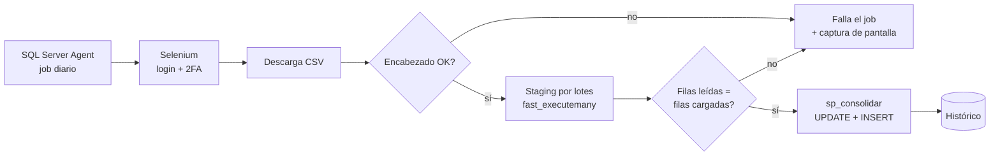

# Ingesta automatizada de reportes web

Bot en **Python + Selenium** que inicia sesión con **doble factor** en un portal web, descarga el reporte diario y lo carga en **SQL Server** por lotes, con control de integridad y consolidación histórica **sin duplicados**.


> **Sobre este repo:** es una versión de demostración de un bot que desarrollé y mantengo en producción, donde procesa reportes de mensajería de **hasta 3 millones de filas diarias**. El portal, las credenciales y los datos reales no se publican. Acá el bot corre contra un **portal de demo local** con datos sintéticos.

---

## Qué resuelve

Descargar el reporte de envíos a mano todos los días y cargarlo no escalaba. El bot:

1. Entra al portal con usuario, contraseña y código de segundo factor (en la demo, **TOTP**).
2. Exporta el reporte y espera a que Chrome termine de escribir el archivo.
3. Valida que el formato no haya cambiado (columnas esperadas).
4. Carga en staging **por bloques** con `fast_executemany`, sin levantar el archivo entero en memoria.
5. Compara filas leídas contra filas cargadas (**control de integridad**).
6. Consolida en el histórico con un stored procedure: **actualiza estados** y **agrega solo los mensajes nuevos**.
7. Corre como job de **SQL Server Agent**. Si algo falla, devuelve código 1, el job queda en error y avisa.



## Cómo correrlo

```bash
pip install -r requirements.txt

# 1. Levantar el portal de demo
python portal_demo/generar_reporte.py
python -m http.server 8765 -d portal_demo

# 2. En otra terminal: bot + carga en SQLite local
python main.py --demo

# Solo la carga, con un archivo ya descargado
python main.py --demo --archivo portal_demo/reporte_mensajes.csv

# Tests
pytest                              # carga, integridad, idempotencia
RUN_E2E=1 pytest tests/test_bot_e2e.py   # bot completo (necesita Chrome)
```

Correr la carga dos veces seguidas muestra que el proceso es **idempotente**:

```
INFO ingesta: OK: 20000 filas leídas, 20000 nuevas en el histórico
INFO ingesta: OK: 20000 filas leídas, 0 nuevas en el histórico
```

## Estructura

```
├── main.py                       # punto de entrada del job (exit code 0/1)
├── bot/
│   ├── config.py                 # configuración por variables de entorno
│   ├── descarga.py               # Selenium: login, 2FA, export, espera de descarga, reintentos
│   └── carga.py                  # staging por bloques, integridad, consolidación
├── sql/
│   ├── 01_ddl.sql                # staging + histórico
│   ├── 02_sp_consolidar_reporte_mensajes.sql
│   └── 03_job_sql_agent.sql      # programación diaria
├── portal_demo/                  # portal ficticio para probar el bot
└── tests/
```

## Decisiones técnicas

| Decisión | Por qué |
|---|---|
| Esperas explícitas (`WebDriverWait`) | Nunca `sleep` fijos: el bot espera a que cada elemento exista. |
| Esperar a que no haya `.crdownload` | Evita leer un archivo a medio escribir. |
| Limpiar la carpeta antes de descargar | Evita cargar por error el archivo de la corrida anterior. |
| Captura de pantalla al fallar | Cuando el portal cambia, la imagen muestra qué pasó sin tener que reproducirlo. |
| Reintentos con pausa | Los portales web fallan por timeouts; tres intentos antes de marcar error. |
| Lectura por bloques + `fast_executemany` | Con millones de filas, cargar todo en memoria o insertar fila por fila no es viable. |
| Staging + stored procedure | La lógica de negocio queda en la base, versionada, y es transaccional. |
| `UPDATE` + `INSERT ... NOT EXISTS` en lugar de `MERGE` | Más simple de leer y de depurar, sin los problemas conocidos de `MERGE` con concurrencia. |
| Credenciales en variables de entorno | Nada sensible en el código ni en el repo (`.env` está en `.gitignore`). |

## Próximos pasos

- Pasar de SQL Server Agent a **Airflow**, con alertas y reintentos por tarea.
- Evaluar la **API REST** del proveedor para reemplazar Selenium: una API es más estable que depender de la interfaz web.

---

Kevin Villagra · [LinkedIn](https://www.linkedin.com/in/kevin-villagra-data/)
